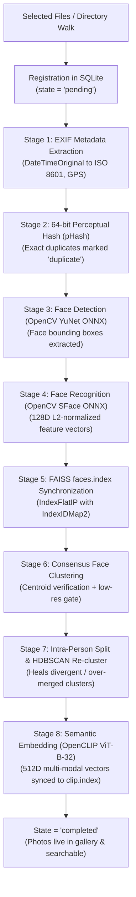
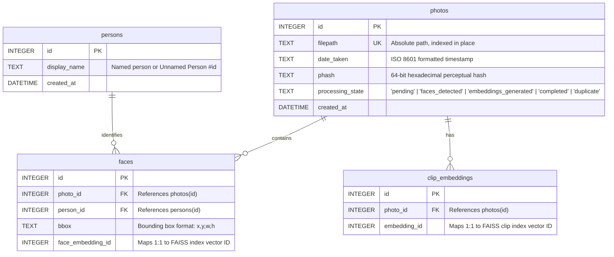
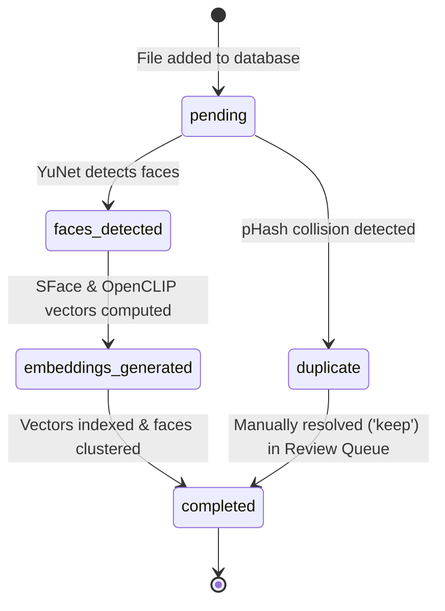

# PhotoVault — System Architecture & Design Document

**PhotoVault** is an offline, privacy-first, local desktop photo manager designed for automatic face clustering, multi-modal semantic search, and duplicate review. All machine learning inference, indexing, and data management operate strictly on-device without cloud services or telemetry.

---

## 1. System Architecture Diagram

```mermaid
flowchart TB
    subgraph Desktop["Desktop Client Layer (Tauri + React)"]
        UI["React 18 + TypeScript UI\n(Photo Grid, People Grid, Duplicate Review)"]
        TAURI["Tauri Desktop Shell (Rust)\n(Windowing, Native Dialogs, Process Supervisor)"]
        UI <-->|IPC / HTTP| TAURI
    end

    subgraph Sidecar["Core Engine (Python 3.11+ / FastAPI Sidecar)"]
        API["REST & IPC Dispatcher (engine/api.py)"]
        INGEST["Ingestion Controller\n(Folder Walk & Multi-File Import)"]
        CV_PIPELINE["Computer Vision & Embedding Pipeline"]
        SEARCH["Search & Vector Retrieval Engine"]
        QUEUE["Background Job Queue (engine/queue.py)"]
    end

    subgraph Storage["Local Storage Layer (Zero-Cloud, In-Place)"]
        DB[(SQLite: vault.db\nRelational Metadata & Job Queue)]
        FAISS_FACE[(FAISS: faces.index\n128D SFace Cosine Search)]
        FAISS_CLIP[(FAISS: clip.index\n512D OpenCLIP Vector Index)]
        RAW_VEC[(face_store/ & clip_store/\nNumPy Vector Archives)]
        DISK[(User Photo Folders\nRead-Only In-Place Storage)]
    end

    TAURI <-->|HTTP (Port 8000)| API
    API --> INGEST
    API --> SEARCH
    API --> QUEUE
    INGEST --> CV_PIPELINE
    CV_PIPELINE -->|Read Image Bytes| DISK
    CV_PIPELINE -->|Write Metadata & States| DB
    CV_PIPELINE -->|Persist Embeddings| RAW_VEC
    CV_PIPELINE -->|Index Vectors| FAISS_FACE
    CV_PIPELINE -->|Index Vectors| FAISS_CLIP
    SEARCH -->|Metadata & Filter Queries| DB
    SEARCH -->|Face Nearest Neighbors| FAISS_FACE
    SEARCH -->|Text-to-Photo Similarity| FAISS_CLIP
```

---

## 2. Ingestion & Computer Vision Pipeline

Ingestion is executed identically by both the recursive folder scanner and the individual file importer through a unified processing function: `run_ingestion_pipeline()`.



---

## 3. Database Schema & Data Model (`vault.db`)

PhotoVault utilizes a single-file SQLite database configured with write-ahead logging (WAL) for concurrent reads and non-blocking asynchronous writes.



### Incremental State Machine

The `processing_state` column drives all processing tasks incrementally so that additions or modifications never trigger a full library rescan:



---

## 4. Vector Search & Similarity Indexes

PhotoVault maintains two high-performance local vector search indexes using **FAISS (Facebook AI Similarity Search)**:

| Index File | Embedding Model | Vector Dim | Metric | Store Location | Primary Use Case |
|---|---|---|---|---|---|
| **`faces.index`** | OpenCV SFace ONNX | 128D (L2 normalized) | Inner Product (Cosine Similarity) | `face_store/` (`.npy` files) | Instant face recognition, matching, and clustering |
| **`clip.index`** | OpenCLIP ViT-B-32 ONNX | 512D (L2 normalized) | Inner Product (Cosine Similarity) | `clip_store/` (`.npy` files) | Natural language text-to-image semantic search |

- **IDMap2 Architecture**: Both indexes wrap FAISS's base `IndexFlatIP` inside `faiss.IndexIDMap2`, ensuring that vector positions map directly to permanent database primary keys (`faces.face_embedding_id` and `clip_embeddings.embedding_id`).

---

## 5. Technology Stack & Architectural Layers

| Layer | Component | Technology | Rationale & Characteristics |
|---|---|---|---|
| **Desktop Shell** | Native Host Window | **Tauri (Rust)** | Ultra-low RAM footprint (~10-15MB), secure native file dialogs, and OS process lifecycle management. |
| **User Interface** | Virtualized SPA | **React 18, TypeScript, Vite** | Fast rendering of thousands of photos, Apple Photos-style native aesthetics, and responsive theme adaptation. |
| **Core Engine** | Background Sidecar | **Python 3.11+, FastAPI** | Machine learning orchestration, ONNX Runtime inference, and thread-safe HTTP API dispatching. |
| **Face Detection** | Bounding Box Localizer | **OpenCV YuNet ONNX** | Extremely fast and lightweight face detection across varied lighting, scales, and angles. |
| **Face Recognition** | Facial Embeddings | **OpenCV SFace ONNX** | Compact 128D representation optimized for real-time CPU clustering and high accuracy. |
| **Semantic Search** | Multi-modal Vision | **OpenCLIP (ViT-B-32)** | Text and image projection into a shared 512D vector space for open-vocabulary search queries. |
| **Clustering** | Unsupervised Grouping | **Consensus + HDBSCAN** | Multi-member consensus eliminates single-linkage chaining; intra-person splitting auto-heals divergent identities. |
| **Database** | Relational Metadata | **SQLite 3 (`vault.db`)** | ACID-compliant, zero-configuration local single-file database. |
| **Vector Search** | Similarity Retrieval | **FAISS (`IndexFlatIP`)** | Sub-millisecond exact cosine similarity search over tens of thousands of vectors. |

---

## 6. Directory Layout & Module Responsibilities

```text
Photo/
├── backups/                    # Timestamped snapshots of database and vector stores
├── docs/                       # Project documentation & visual assets
│   ├── screenshots/            # UI screenshots (photos grid, people view, duplicate review)
│   └── ARCHITECTURE.md         # System architecture and technical design document
├── engine/                     # Core Python Backend Engine
│   ├── api/                    # REST / IPC routes (photos, persons, duplicates, scan, import)
│   ├── db/                     # SQLite schema definitions, migrations & connection pool
│   ├── clip.py                 # OpenCLIP ONNX model wrapper & vector index sync
│   ├── cluster.py              # Multi-member consensus face clustering & quality gating
│   ├── config.py               # Application configuration and model paths
│   ├── duplicates.py           # Perceptual hash and vector cosine duplicate detection
│   ├── embeddings.py           # SFace 128D embedding generator & numpy vector store
│   ├── exif.py                 # EXIF timestamp parsing & GPS extraction
│   ├── faces.py                # OpenCV YuNet face detector & bounding-box crop
│   ├── hasher.py               # 64-bit dHash/pHash computation & Hamming distance
│   ├── index.py                # FAISS IndexFlatIP + IndexIDMap2 wrapper
│   ├── main.py                 # FastAPI application runner & sidecar startup handshake
│   ├── queue.py                # SQLite-backed background job queue & async workers
│   ├── recluster.py            # Global HDBSCAN re-clustering & intra-person auto-splitting
│   ├── scanner.py              # In-place directory sync & filesystem reconciliation
│   └── watcher.py              # Non-polling OS filesystem change watcher
├── models/                     # Local ONNX weights (YuNet, SFace, OpenCLIP)
├── scripts/                    # Standalone CLI tools (scan.py, package_engine.py)
├── src-tauri/                  # Tauri (Rust) desktop shell source & configuration
├── tests/                      # Comprehensive test suite (100 backend + 8 frontend tests)
├── ui/                         # React 18 + TypeScript + Vite frontend application
├── vault.db                    # Primary SQLite metadata database
├── faces.index                 # FAISS vector index for face recognition
├── clip.index                  # FAISS vector index for semantic search
├── photovault_engine.spec      # PyInstaller standalone sidecar specification
├── AGENTS.md                   # Agent protocol, architecture contracts & constraints
├── BACKLOG.md                  # Task roadmap & status
├── GUARDRAILS.md               # Safety guidelines & known edge cases
├── PROGRESS.md                 # Iteration audit log & changelog
└── README.md                   # Getting started guide & operational instructions
```

---

## 7. Core Architectural Guarantees

1. **Strict Zero-Cloud Privacy**: No photo or facial embedding data ever leaves the local machine. There are zero external API calls or telemetry pings.
2. **In-Place Indexing**: User photos remain strictly in their original filesystem locations. Files are never moved, renamed, or copied.
3. **Chaining Resistance & Self-Healing**: Consensus verification prevents false transitive bridges (Person A matches B, B matches C, but A $\neq$ C), while intra-person splitting automatically detects and separates merged clusters.
4. **Resilient Error Containment**: Corrupted or unreadable image files are gracefully bypassed during processing without failing batch imports or halting background queue execution.
